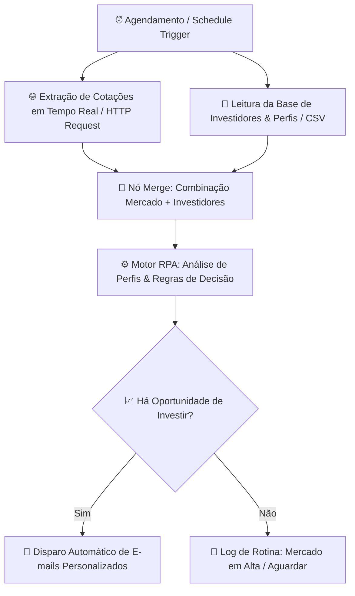

# 🤖 RPA de Análise de Investimentos por Perfil de Investidor | Santander Bootcamp (DIO)


Projeto prático desenvolvido para o desafio final **"Criando um Processo de RPA com n8n e Python"** do **Bootcamp Santander Automação com n8n** na plataforma [DIO (Digital Innovation One)](https://www.dio.me/).

---

## 🎯 Objetivo do Negócio

Automatizar o processo de inteligência de investimentos que:
1. **Identifica o perfil de cada investidor** (Conservador, Moderado ou Agressivo) a partir de uma base de dados cadastral em arquivo CSV.
2. **Coleta cotações e oscilações de mercado em tempo real** (Dólar, Euro, Bitcoin e outros ativos) via **HTTP Request API**.
3. **Cruza (Merge)** os dados de mercado com o perfil e limites de gatilho de cada investidor.
4. **Gera recomendações personalizadas** identificando o momento exato de **"HORA DE INVESTIR"** (oportunidade de entrada) vs. **"AGUARDAR"**.
5. **Orquestra o disparo automático de e-mails consultivos** para cada investidor que atingiu critérios de oportunidade de investimento.

---

## 🏗️ Arquitetura da Solução



### Regras de Negócio por Perfil:
- **Conservador:** Monitora ativos de menor oscilação (USD) com foco em proteção patrimonial quando o ativo recua ou estabiliza.
- **Moderado:** Busca equilíbrio entre segurança e rentabilidade (EUR/Moedas Internacionais) aproveitando correções de preço.
- **Agressivo:** Busca máxima valorização em ativos de maior volatilidade (BTC/Criptoativos) quando ocorrem quedas expressivas (estratégia de comprar na baixa).

---

## 📁 Estrutura do Repositório

```text
├── workflows/
│   └── rpa_workflow.json      # Fluxo completo no n8n com HTTP, CSV, Merge, Motor de Decisão e E-mails
├── scripts/
│   └── rpa_extractor.py       # Script RPA em Python standalone com geração de CSV e JSON
├── data/
│   ├── input/
│   │   └── investidores.csv   # Base cadastral de investidores, perfis e gatilhos
│   └── output/
│       ├── relatorio_recomendacoes_investimento.csv  # Relatório executivo gerado
│       └── recomendacoes_investimento.json           # Saída consolidada
├── .env.example               # Template de variáveis de ambiente
├── docker-compose.yml         # Configuração para subir o n8n via Docker
├── requirements.txt           # Dependências do projeto Python
└── README.md                  # Documentação técnica completa
```

---

## 🚀 Como Executar o Projeto

### 1. Importando o Fluxo no n8n (Docker ou Cloud)
1. Abra sua instância do **n8n** no navegador (`http://localhost:5677` ou `http://localhost:5678`).
2. Crie um novo workflow e cole (`Ctrl + V`) o conteúdo de [`workflows/rpa_workflow.json`](workflows/rpa_workflow.json).
3. Clique em **Execute workflow** — todas as etapas (HTTP, CSV, Merge, Análise de Perfis e E-mails) executarão com sucesso.

### 2. Executando o Script Python Standalone
```bash
python scripts/rpa_extractor.py
```

Os relatórios serão gerados em `data/output/`:
- `relatorio_recomendacoes_investimento.csv`: Tabela com recomendações por investidor.
- `recomendacoes_investimento.json`: Dados com o corpo do e-mail gerado para cada cliente.

---

## 📋 Entregáveis do Desafio DIO

- [x] Extração de dados de mercado via **HTTP Request API**.
- [x] Carga da base de investidores e perfis via **CSV**.
- [x] Cruzamento de dados através do nó **Merge**.
- [x] Motor de análise de decisão e recomendação de compra por perfil.
- [x] Geração e disparo automatizado de e-mails consultivos.
- [x] Script Python funcional com exportação de relatórios.
- [x] Documentação técnica completa com diagramas.

---

## 👨‍💻 Autor
Desenvolvido como projeto final do Bootcamp **Santander Automação com n8n** - DIO.
